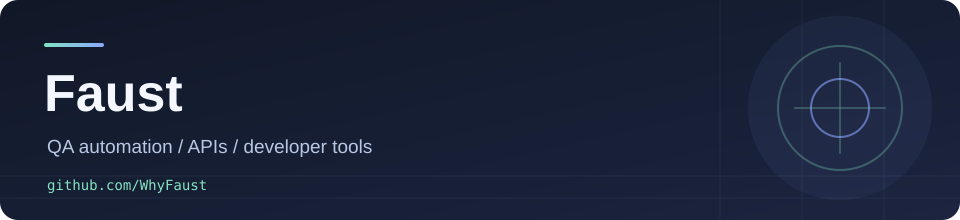

  

<h3 align="center">Build useful things. Keep the boundaries clear.</h3>

  QA automation engineer · Python · integrations · tools for developers

  <a href="https://github.com/WhyFaust?tab=repositories">Projects</a> ·
  <a href="https://t.me/WhyFaust_tv">Telegram</a>

---

Hi, I'm **Faust**. I work in test automation and build practical tools around APIs, local developer workflows and game servers. Here are three places to start:

---

Привет! Пишу про разработку, автоматизацию и то, что действительно удалось проверить — <a href="https://t.me/WhyFaust_tv">@WhyFaust_tv</a>.

